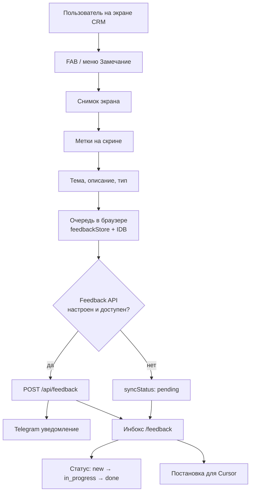

# Процесс: замечание (Ревизор)

Схема фазы A (локальная очередь + опциональный Termux API / Telegram).

## Статусы

`new` → `in_progress` → `done`

## Документация модуля

Полное описание API, полей и бота: [modules/feedback.md](../modules/feedback.md).
